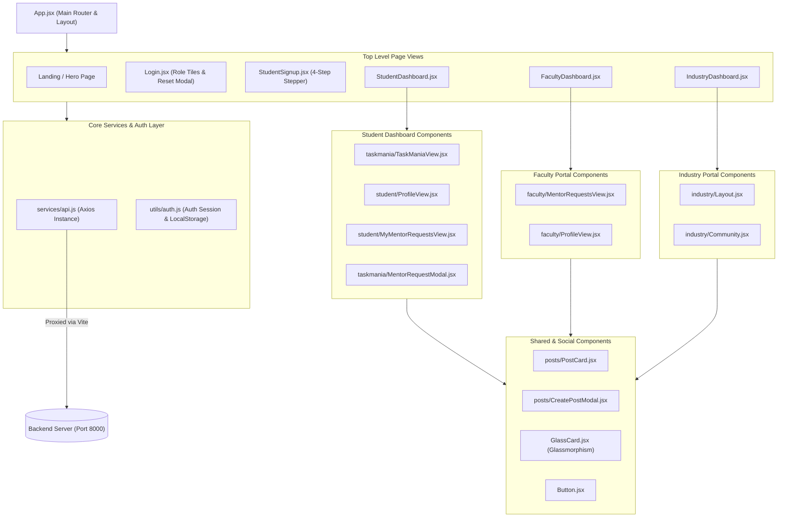
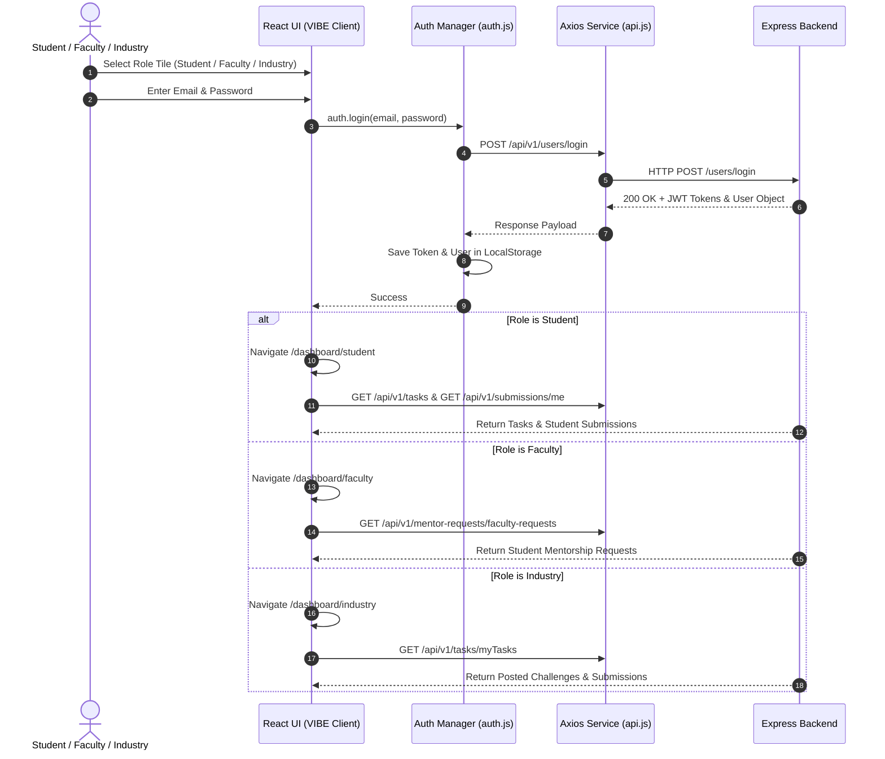

# VIBE Client (Frontend Web Application)

[](https://react.dev/)
[](https://vitejs.dev/)
[](https://tailwindcss.com/)
[](https://web.dev/progressive-web-apps/)

**VIBE Client** is the progressive, interactive single-page web application for the VIBE Platform (Verified Internship & Mentorship System). Built with React 19, Vite, Tailwind CSS, Framer Motion, and Lucide Icons, it delivers a modern glassmorphic interface tailored for Students, Faculty Mentors, and Industry Experts.

---

## Key Features

- **Student Dashboard**: Browse verified task challenges (Task Mania), submit solutions, track mentorship requests, and view generated Virtual Resumes.
- **Faculty Mentor Portal**: Review incoming mentorship requests from students, approve or reject requests, and track student progress.
- **Industry Portal**: Create and manage industry task challenges, evaluate student solution submissions, and hire verified talent.
- **Multi-Step Signup & Role Switcher**: Interactive 4-step stepper with instant email OTP verification and role selection.
- **Community Feed**: Expressive social feed with post creation, comment threads, attachment previews, and interactive vibe upvoting.
- **Progressive Web App (PWA)**: Built-in service worker caching, offline capability, and installable app manifest.
- **Vite Proxy & API Layer**: Integrated Axios client with automatic Bearer token injection and Vite dev server proxying to backend (`/api/v1` -> `http://localhost:8000`).

---

## Frontend Component & Module Architecture



---

## Multi-Role Navigation & User Journey Flow



---

## Directory Structure

```
vibe-client/
├── public/                 # Favicons, PWA icons, static assets
├── src/
│   ├── components/         # Modular UI components
│   │   ├── faculty/        # Faculty portal views
│   │   ├── industry/       # Industry portal views
│   │   ├── posts/          # Community post & comment modals
│   │   ├── shared/         # Common layout wrappers
│   │   ├── student/        # Student dashboard views
│   │   ├── taskmania/      # Task challenge & submission views
│   │   ├── Button.jsx      # Reusable button component
│   │   └── GlassCard.jsx   # Glassmorphic UI wrapper
│   ├── pages/              # Primary route pages
│   │   ├── FacultyDashboard.jsx
│   │   ├── IndustryDashboard.jsx
│   │   ├── Login.jsx
│   │   ├── StudentDashboard.jsx
│   │   └── StudentSignup.jsx
│   ├── services/
│   │   └── api.js          # Axios client with interceptors & proxy config
│   ├── utils/
│   │   └── auth.js         # Authentication state & session manager
│   ├── App.jsx             # React router declaration
│   ├── index.jsx           # React DOM root render
│   └── types.js            # JSDoc type definitions
├── index.html              # HTML5 entry point
├── vite.config.js          # Vite config, dev proxy & PWA plugin settings
├── package.json
└── README.md
```

---

## Environment Configuration

You can optionally configure environment variables in `.env` or `.env.local` inside `vibe-client`:

```env
# Optional explicit API Base URL (Defaults to relative /api/v1 via Vite proxy)
VITE_API_BASE_URL=http://localhost:8000/api/v1

# Optional Gemini API Key for AI features
GEMINI_API_KEY=your_gemini_api_key_here
```

### Vite Dev Proxy Setup
The client uses Vite's built-in development proxy configured in `vite.config.js`:
```js
server: {
  port: 3000,
  proxy: {
    '/api': {
      target: 'http://localhost:8000',
      changeOrigin: true,
      secure: false,
    },
  },
}
```

---

## Getting Started

### Prerequisites

- **Node.js**: `v18.0.0` or higher
- **npm**: `v9.0.0` or higher

### Development Setup

1. **Install Dependencies**:
   ```bash
   npm install
   ```

2. **Start Development Server**:
   ```bash
   npm run dev
   ```
   The application will run at **`http://localhost:3000`**.

3. **Build for Production**:
   ```bash
   npm run build
   ```

4. **Preview Production Build**:
   ```bash
   npm run preview
   ```

---

## License

Distributed under the **ISC License**.
